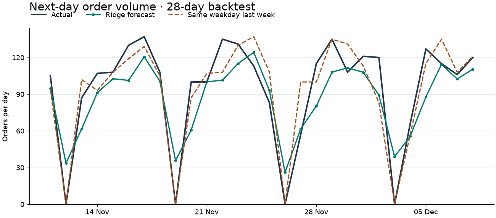

# Daily Order Forecast

How many orders should a warehouse expect tomorrow? This project uses a year of real online retail transactions to forecast the next day's order volume. It compares a small Ridge regression model with a rule a planner could use today, taking the order count from the same weekday last week.

## Results

The backtest covered 11 November through 8 December 2011. Lower mean absolute error means the forecast was closer to the actual daily order count.

| Approach | Mean absolute error (orders/day) |
| --- | ---: |
| Same weekday last week | **11.75** |
| Ridge regression | 18.96 |

The weekly rule was more accurate on this holdout. It also matched the recurring zero-order days, where Ridge still predicted orders.



## Run locally

Use Python 3.12. Download the official CSV and save it as `data/raw/online-retail.csv`. [Download from UCI](https://archive.ics.uci.edu/static/public/352/data.csv)

Run these commands from the project folder in PowerShell.

```powershell
python -m venv .venv
.\.venv\Scripts\python.exe -m pip install --only-binary=:all: -r requirements.txt
.\.venv\Scripts\python.exe forecast.py
```

On macOS or Linux, use `.venv/bin/python` for the last two commands. The script writes `outputs/backtest.csv` and `outputs/backtest.png` and prints a historical example for the day after the last complete date.

## How the forecast works

1. Count each six-digit invoice once, on the date of its earliest line with positive quantity and unit price. This counts paid orders and excludes cancellation invoices. Remove the first and last dates because the collection window may contain partial days. Set calendar days with no eligible invoices to zero.
2. For each target day, use its weekday, yesterday's order count, the count seven days earlier, and the previous seven days' average.
3. Train on earlier dates and hold out the final 28 calendar days. Each one-day-ahead prediction can use actual orders through the previous day. Evaluate both approaches on the same dates using mean absolute error in orders per day.

The repository includes an aggregate results chart. Git ignores the raw dataset, generated outputs, and environment files. The script reads a local CSV and fits its model in memory.

The source is Daqing Chen's *Online Retail* dataset (2015), published by the UCI Machine Learning Repository under CC BY 4.0. [Dataset and attribution](https://doi.org/10.24432/C5BW33)
